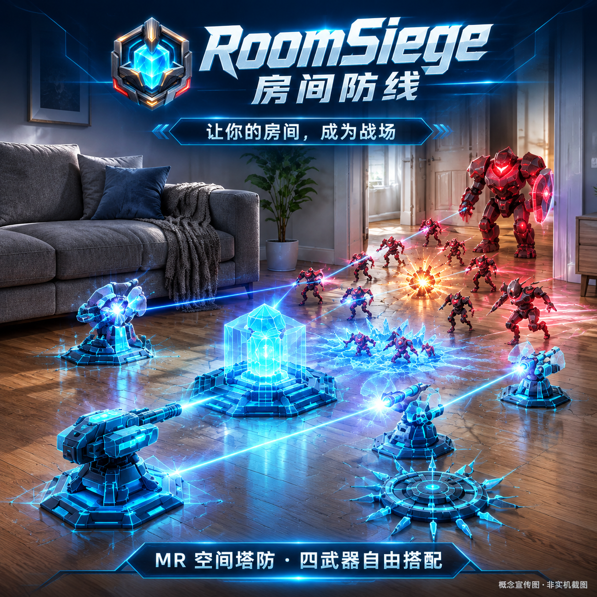

# RoomSiege · 房间防线

**让你的房间，成为战场。**

RoomSiege 是基于 Unity 与 PICO OpenXR 的 MR 空间塔防游戏。在真实房间或模拟沙盘中部署全息防御武器，搭配控制、增益与爆破道具，抵御敌人波次并守护核心。



## 游戏内容

- **房间即战场**：PICO 透视、空间锚点与房间地板读取，0.4m 部署格；读取失败时使用虚拟客厅沙盘。
- **四武器阵容**：18 种武器中选择 4 种出战；机枪、冰墙、激光、陷阱为免费基础武器，其余通过局外商店解锁。
- **塔防策略**：部署、三级升级、卖出、目标选择、减速、破盾、范围伤害及武器协同。
- **完整战局**：10 波敌人，Grunt、Runner、Tank、Shielded 与 Boss，休闲 / 标准 / 硬核三档难度，胜负结算和重新开局。
- **局外成长**：本地奖励、武器商店、54 款精英 / 史诗 / 传说皮肤、12 类消耗道具、收藏图鉴与本地记录。
- **空间交互**：手柄射线、抓取与点击，世界空间面板，放置时收起大面板，选中高亮及输入穿透防护。
- **体验反馈**：首次教学、波次提示、空间音效、背景音乐与局内反馈。无账号登录，进度保存在本机。

## 当前版本

- 版本：`0.1.0`（versionCode `1`），**MR 体验预览版**。
- Android 包名：`com.roomsiege.mr`。
- Unity：**6000.6.8f1**，Android / ARM64 / IL2CPP / OpenGLES3。
- PICO Unity Integration SDK：**6.1.1**，OpenXR **1.18.0**。

这是可继续开发的完整游戏工程，不代表所有设备场景均已验证。Unity 6 的编辑器编译与主菜单运行检查通过。针对真机启动时房间查询返回 0 个锚点的问题，源码已加入定位就绪等待、服务重连和后台恢复处理，扫描模块 52 项 EditMode 测试通过；**本次恢复修复尚待真机复测**。运行效果以真机为准；宣传图为概念画面。

## 获取并打开

1. 克隆本仓库：

   ```powershell
   git clone https://github.com/ultimetamr/RoomSiege.git
   cd RoomSiege
   ```

2. 通过 Unity Hub 安装 **6000.6.8f1**，勾选 Android Build Support、Android SDK & NDK Tools、OpenJDK。
3. 从 PICO 官方开发者网站获取 **PICO Unity SDK 6.1.1**，自行阅读并接受其许可，解压到本机。
4. 在第一次打开 Unity **之前**，接入本地 SDK。将以下路径改成自己的安装路径：

   ```powershell
   powershell -ExecutionPolicy Bypass -File .\Tools\Setup-Dependencies.ps1 `
     -SdkPath "D:\PICO-Unity-SDK-6.1.1\XR" `
     -UnityEditorPath "D:\Unity\6000.6.8f1\Editor"
   ```

   脚本不联网下载 SDK，不修改原始 SDK；会复制到忽略跟踪的 `Packages/com.bytedance.pico.xr`，应用项目所需的兼容调整，恢复空间音频库别名，并从已安装 Unity 中复制 Composition Layers 2.6.0 包。

5. Unity Hub 添加仓库根目录，用 **6000.6.8f1** 打开。等待依赖导入，打开 `Assets/Scenes/RoomSiege_Start.unity`，进入 Play Mode。
6. 真机上由使用者处理空间数据等权限。桌面编辑器与模拟沙盘不能代替真实房间验收。

详细环境与故障处理：[构建指南](Docs/BUILDING.md)。

## 工程结构

```text
Assets/
  Data/          配置、18 武器定义、难度计算、测试
  Scan/          房间读取、部署格、安全区、入口、沙盘
  Towers/        武器交互、放置、升级、战斗与外观
  Enemies/       敌人、对象池、移动、护盾与 Boss
  Waves/         波次调度、准备期、状态推进
  UI/            世界空间面板、教学及输入反馈
  Audio/         音乐、音效与空间音频适配
  Meta/          商店、皮肤、道具、图鉴和本地存储
  Visuals/       视觉风格、品牌图标、UI 组件
  Diagnostics/   真机测试报告与诊断
  Editor/        工程配置及 Android 构建入口
Tools/           模型生成工具、本地依赖接入脚本
Docs/            构建说明、版本说明、作品介绍与宣传素材
```

## 编译与测试

Unity 菜单 **RoomSiege → Build Android APK**，输出 `Builds/RoomSiege.apk`。图标导出钩子同时设置普通与自适应图标，避免回退为 Unity 默认图标。

EditMode 测试位于各模块的 `Tests/EditMode` 以及 `Assets/UI/Tests/EditMode`。通过 **Window → General → Test Runner → EditMode** 运行。2026-11-07 房间恢复修复通过扫描模块 52 项测试与 Android 脚本编译，并已生成测试 APK；本次未重新运行全工程测试，真机复测待完成。历史检查范围见 [Unity 6 兼容记录](Docs/Unity6Compatibility-2026-11-06.md)。

## 第三方依赖与公开范围

仓库提交全部 RoomSiege 游戏源码、场景、配置、自有模型及图像、测试与工具源码。Unity 缓存、APK、日志、存档、签名材料，以及禁止公开再分发的 PICO SDK 源码 / 二进制不提交。PICO SDK 和 Unity 包须通过各自官方渠道获取，详见 [第三方依赖说明](THIRD_PARTY_NOTICES.md)。

公开仓库不自动改变第三方或项目素材的许可，也不代表 PICO 官方出品或背书。仓库暂未授予统一的开源许可；使用或再分发代码、品牌和素材前请联系维护者。

## 作品资料

- [版本说明](CHANGELOG.md)
- [可直接用于作品提交的中文介绍](Docs/Submission.zh-CN.md)
- [作品图标（1024×1024 PNG）](Docs/Media/RoomSiege-Icon-1024.png)
- [宣传海报](Docs/Media/RoomSiege-Poster.png)
